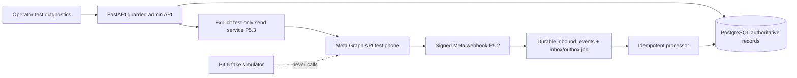

# HERMECIOUS — BATCH 08 | Official WhatsApp Business Platform Integration

**Execution scope:** P5.1 → P5.2 → P5.3, sequential and separately verified.  
**First market / vertical:** Lahore, Pakistan / independently operated schools.  
**Executor:** Claude Opus 5.5 High, one subphase per coding request.  
**Artifact status:** Engineering specification only. No application implementation, Meta account access, webhook configuration, API request or real message has been performed by this document.  
**Parent contract:** `docs/HERMECIOUS_EXECUTION_BLUEPRINT_v1.md` plus accepted ADRs and P0–P4.5 implementation/specification ledgers.  
**Integration reference date:** 2026-10-25. Verify Meta Graph API version, fields, permissions, test-phone setup, business-template rules and SDK status from current Meta docs immediately before implementation. Pin only a supported version confirmed in that environment; never blindly copy a version number from a blog.

## 0. Purpose, dependencies and nonnegotiable boundaries

Hermecious now has discovery, accounts, evidence, qualification, drafts, permissions, exact-version content approval and an offline simulator *by design*. Batch 08 introduces official **Meta WhatsApp Cloud API** contracts, signed inbound webhook handling, and an isolated **real test send** through a Meta-provided test business phone number to a preauthorized operator-controlled recipient. **Do not enable production prospect outreach, agent replies, bulk sending or general campaign dispatch in this batch.** The Meta test path transmits an actual WhatsApp message; it must never be described as a dry run.

| Slice | Prerequisite actually inspected in repository | Owns | Does not own |
|---|---|---|---|
| P5.1 | P0.4 errors/config/logging; P1.5 durable job/outbox interfaces; P4.3 policy and P4.5 no-egress simulator | Versioned WhatsApp provider contracts, explicit test/production configuration boundary, transport implementation behind a non-dispatchable interface, fake/HTTP contract tests | HTTP webhook endpoint, credential onboarding UI, any network send or runnable dispatcher |
| P5.2 | P5.1 DTOs/provider identity; P1.5 durable events; P1.2 org-scoped records; P4.3 permission policy | GET verification, POST HMAC authentication, durable inbound events, idempotent processors, inbound message/status normalization | Auto-replies, marketing consent issuance, outbound sending, auto-admitting strangers as school accounts |
| P5.3 | P5.1 typed transport; P5.2 verified status ingestion; P4.3 restrictions; P4.4 approved content contract; P4.5 isolation | Read-only authoritative template catalog, operator-restricted test-account transmission, audited provider message/status correlation | Real prospect campaigns, provider marketing automation, P5.4 full inbox UI, P5.5 production go/no-go |

### 0.1 Authority and safety rules

1. **Meta Cloud API only.** Do not use WhatsApp Web, unofficial QR/puppeteer bots, arbitrary BSP proxy, or phonebook scraping. The business identity and Meta phone-number ID are explicit configured bindings.
2. **Real sending stays disabled by default.** `HERMECIOUS_LIVE_OUTBOUND_ENABLED=false` from Batch 07 must stay false and cannot be enabled by P5.1–P5.3. The *separate* test-only transport permission is **not** an override for production sending. Neither environment variable nor feature flag should silently elevate production capability.
3. **Test transmission is real.** P5.3 may send a single, explicitly confirmed, Meta-authorized template to a registered allowlisted recipient from an official Meta test phone number. It never pulls recipients from school accounts, campaigns or sourced contact addresses.
4. **Policy is server-side and fresh.** No LLM, UI request or async job can bypass global safety locks, opted-out recipient protections or a real approved template check. Public phone number ≠ opt-in. A test recipient's operator-provided verification is limited to test scope, never reusable as marketing consent.
5. **No sent/delivered confusion.** A Graph API response indicating `messages[].id` means provider accepted the call; `sent`, `delivered`, `read`, `failed` are separate webhook observations, not immediate guarantees. Webhook deliveries can arrive out of order or be replayed; preserve the event log and reconcile safely.
6. **Incoming messages are untrusted content but authenticated transport facts.** Verify the webhook cryptographically and scope it to the configured WABA and phone-number ID. Do not treat text as policy instructions or proof of sales eligibility. A real inbound message can establish a real 24-hour service-window timestamp; it does not create marketing permission.
7. **No P3.4 bypass.** The 30-real-Lahore-school evidence-quality gate remains mandatory for prospect campaign activation. Meta test messages use only isolated test contacts even if no Lahore research gate is passed.
8. **Fail closed.** Unset production credentials, unsupported Graph version, unmatched account identifiers, missing template approval, invalid signature, revoked/suppressed test recipient, unknown outcome or already-running attempt must produce typed blocked/uncertain status and no speculative send.

### 0.2 Trust/data flow



**Trust boundaries:** Meta receives requests only from a configured test client with credentials loaded from a secret source. Incoming HTTPS webhooks are unauthenticated until raw-body HMAC verification and configured WABA/phone binding succeed. Internal processing is transactionally deduplicated. Model-generated text is never a transport command.

### 0.3 Configuration matrix

| Mode | Permitted | Forbidden |
|---|---|---|
| `simulation` | Existing FakeWhatsAppTransport; deterministic no-egress tests | Meta clients, provider token/phone ID, live Graph call |
| `contract_test` | Local fake HTTP responder, signed webhook fixture and isolated test DB | Internet egress to Meta |
| `provider_test` | Explicit operator-owned recipient allowlist, pinned test phone + WABA, fixed single-recipient template only, live egress confirmation | Any real lead/campaign recipient, bulk dispatch, free-text send, agent send |
| `production` | Inbound webhook processing, read-only template status (if provisioned), operator-facing safe diagnostics | Any outbound dispatch until P5.5 go/no-go and distinct subsequent authorization |

`provider_test` MUST require a designated non-production environment, test-only WABA/phone ID and server-side allowlist and must refuse to start if pointed at configured production phone-number IDs or if its identities cannot be proven test-only. Treat ambiguity as BLOCKED, not as a presumed test account. Avoid production-sourced contacts entirely. Egress allowlisting and DNS/TLS verification are mandatory; do not accept arbitrary `base_url` or callbacks from user-controlled payloads. HTTPS and official Graph API hostname for live test connections; fake-local endpoints are restricted to test runtime. Verify deployment environment identities using the Meta developer dashboard and an explicit operator checklist, rather than inferring safety from names alone.

### 0.4 Shared identity, privacy and schema invariants

- Existing `organization_id` remains authoritative. Provider connection belongs to exactly one org and WABA and approved phone-number ID(s); a signed callback for some other account cannot attach records to the first organization.
- Store provider IDs, template name/language/category/status/timestamps and **non-sensitive** error codes. Access tokens, app secrets, verify tokens, raw recipient numbers, complete webhook bodies and unmasked message content must not appear in logs, UI exports or execution ledgers.
- Minimize retained webhook payload: signature-verified normalized items and an encrypted, TTL-limited raw envelope only if justified for diagnostics. Do not retain unnecessary profile or group/contact data; no student/parent data collection.
- Use existing encryption/redaction and keyed contact identity digests from P4.3; no duplicate credential or phone-number store. Define retention/deletion windows as configurable documented policy, not guessed provider requirements.
- All timestamps in UTC (timezone-aware); local business hours use IANA `Asia/Karachi` only when relevant. Unique indexes and locking must be scoped correctly across provider/app/WABA/phone ID.
- A test contact belongs to a separately flagged isolated test-recipient registry, **not** `accounts` or `campaign_accounts`. Names, public business phones and lead-derived numbers must never be auto-imported to that registry.
- Durable processing lives in Postgres as per P1.5, not Redis as sole record. An ACK may be issued only after durable commit.

---

## P5.1 — Typed official WhatsApp adapter and transport contracts

### Goal and real user outcome

An engineer can configure the transport **without a production send path**, run deterministic API contract tests against local HTTP stubs, see structured provider errors, and prove that existing P4.5 simulation remains 100% disconnected from the provider. API version, supported capabilities and test mode are documented. All implementations must use interfaces already present where compatible; do not create duplicate transports or entire new frameworks.

### P5.1.1 Concrete interfaces

Adapt types to repo conventions; below names are canonical semantics, not mandatory file paths:

```python
class ProviderEnvironment(str, Enum):
    SIMULATION = "simulation"
    CONTRACT_TEST = "contract_test"
    PROVIDER_TEST = "provider_test"
    PRODUCTION = "production"

class OutboundKind(str, Enum):
    TEMPLATE = "template"
    SERVICE_TEXT = "service_text"  # typed but NOT send-capable in P5.1-5.3

class SendIntent(BaseModel):
    operation_id: UUID
    organization_id: UUID
    provider_connection_id: UUID
    purpose: Literal["marketing", "utility", "service_reply", "operator_test"]
    recipient_ref: UUID              # internal ref, never free-form phone from agent
    kind: OutboundKind
    template_name: str | None
    template_language: str | None
    template_components: list[dict] | None = None
    draft_revision_digest: str | None
    approval_id: UUID | None
    policy_revision: str
    created_at_utc: datetime
    idempotency_key: str

class SendResult(BaseModel):
    operation_id: UUID
    outcome: Literal["accepted", "definitive_rejected", "indeterminate"]
    provider_message_id: str | None
    provider_error_code: str | None
    retriable: bool
    received_at_utc: datetime

class DeliveryUpdate(BaseModel):
    provider_message_id: str
    phone_number_id: str
    status: Literal["sent", "delivered", "read", "failed", "unknown"]
    provider_timestamp_utc: datetime
    error_code: str | None = None
    dedupe_key: str

class IncomingMessage(BaseModel):
    provider_message_id: str
    phone_number_id: str
    sender_identity_ref: str  # normalized and encrypted/keyed internally
    provider_timestamp_utc: datetime
    kind: Literal["text", "image", "document", "interactive", "unsupported"]
    safe_content_ref: str | None
    dedupe_key: str
```

Additional contract: `TemplateDescriptor {waba_id, template_id, name, language, category, provider_status, components_digest, fetched_at_utc, source='meta', supported_params_schema}`; `ProviderError {public_code, http_status, retry_class, safe_message, correlation_id}`; `ProviderConnection {org_id, waba_id, phone_number_id, graph_version, mode, enabled, credential_ref}`; `MessagingTransport` with `send_template(intent, resolved_test_recipient, authoritative_template)`, `parse_send_response`, `health_check` (read-only/credential-safe), plus factory `build_transport(mode)` that forbids elevation. Signature/webhook payload parsing follows in P5.2.

### P5.1.2 Network/SDK decision

- Prefer a small HTTPX client on the official Meta Cloud API over archived example SDKs. Confirm current official API spec and Graph version just before implementation. `POST https://graph.facebook.com/{version}/{phone-number-id}/messages` is the official send endpoint; no alternate arbitrary URL. Authorization bearer token in server-side secrets only. Read-only template endpoint belongs to P5.3.
- `httpx.AsyncClient` (if already in repo), strict connect/read/total timeouts, response-body cap, JSON schema validation, bounded connections. Never log the Authorization header or full payloads. Inject transport/fake HTTP layer for tests. TLS verification required. Set user-agent, request correlation and a bounded safe retry classification.
- For future sender: no automatic retries after a send timeout where Graph may have accepted the message; persist `indeterminate`, require reconciliation/human handling. A definitive rate-limit/error response may be retryable subject to allowance, but no P5.1 send jobs are to exist.
- Graph API may not honor an arbitrary client-supplied idempotency header on message send. **App idempotency is an internal guarantee** only; it cannot magically make a network POST exactly-once. Define the network uncertainty in ADR and acceptance checks.
- Payload allowlists: template messages only, approved non-empty name, supported language, bounded components and parameters, no unsupported media. Do not render arbitrary personalized P4.2 text into a pre-approved template unless placeholder types, template policy and exact human-approved content align.
- Construct paths from sanitized validated config IDs and pinned Graph host; forbid SSRF, path injection or arbitrary domain override in live modes. In tests support in-memory MockTransport without granting network access.

### P5.1.3 Suggested tasks

1. **P5.1.1 Inventory** P4.5 Fake transport, P1.5 job registry and P0.4 error conventions. Capture actual SHA, dirty worktree, migration head and baseline tests. Decide adapter normalization via ADR only for material gaps.
2. **P5.1.2 DTOs** Add versioned Pydantic provider models and explicit provider/environment configuration parsing; document test/production allowlist boundaries. Validate unknown fields, lengths, timestamps, enums and matching organization IDs.
3. **P5.1.3 Adapter** Implement provider HTTP adapter, response parsing and error taxonomy behind an inaccessible-for-now send operation; dependency-injected fake HTTP and no live side effect in normal runtime.
4. **P5.1.4 Contract tests** Exercise synthetic good/bad payloads, 401/403/429/5xx, malformed response, timeout ambiguity, version mismatch, token redaction, SSRF and fake-only isolation.
5. **P5.1.5 Verify** Static/contract tests, inspect route registry/job handlers for **zero live dispatch**; ledger+ADR, explicit P5.2 readiness; STOP.

### P5.1 acceptance matrix

| ID | Scenario | Required test evidence |
|---|---|---|
| `WAAD-01` | Valid template intent | Schema validates, approved content placeholders typed and capped; no message transmitted |
| `WAAD-02` | Untrusted agent/client suggests phone or URL | Ref-only recipient, verified config host and transport refuse arbitrary destination |
| `WAAD-03` | Explicit environment factory | Simulator/fake cannot instantiate provider client, production outbound remains disabled |
| `WAAD-04` | Valid stubbed 200 Graph response | Accepted with `wamid` correlation, **not** delivered status |
| `WAAD-05` | Stubbed 400/401/403/429/5xx | Typed non-sensitive provider errors and explicit retry classes |
| `WAAD-06` | Socket timeout after POST might have arrived | `indeterminate`, no implicit resend/job enqueue |
| `WAAD-07` | Malformed/oversized/mismatched Graph response | Schema error/blocked, no invented provider IDs |
| `WAAD-08` | Token, app secret and recipient included in inputs | Logging/trace/UI redaction and no test fixture secret exposure |
| `WAAD-09` | Two organizations / incompatible WABA bindings | Cross-org access denied and no credential fallthrough |
| `WAAD-10` | Existing P4.5 simulation and API tests | No network/provider call; no outbound job/route enabled |

**Rollback:** Disable WhatsApp adapter binding and clear test credential injection; preserve simulations and all P4.3 suppressions/approvals. No provider operation should exist to undo. If schema expanded, use forward migration rollback or fail-closed disabled adapter—not destructive deletes.

---

## P5.2 — Signed webhook receiver, durable event inbox and reconciliation

### Goal and journey

Meta can challenge and verify a scoped HTTPS callback endpoint. A correctly signed, configured `messages` or `statuses` POST is durably received **before 2xx**, and background processing records a normalized inbound observation exactly once logically, even after duplicate delivery and worker crash. Unknown/forged callbacks cannot affect any account. A verified inbound event creates a trusted last-inbound timestamp **only for the verified sender/conversation**; it never grants marketing permission or sends a reply.

### P5.2.1 GET challenge and POST signature

Suggested, adapt to current routing style:

```text
GET  /api/v1/integrations/whatsapp/webhook?hub.mode=subscribe&hub.verify_token=...&hub.challenge=...
POST /api/v1/integrations/whatsapp/webhook
```

- **GET:** Exact `hub.mode='subscribe'`; compare verification token with `hmac.compare_digest` / constant-time method; non-empty bounded challenge returned as `text/plain` only on success. Reject missing/oversized/suspicious parameters or wrong token. No admin browser session required for Meta challenge; never echo verification token or unexpected challenge. Production requires HTTPS.
- **POST:** Obtain unmodified *raw bytes* before any JSON parsing, including body-size cap (config with justified initial bound), content type constraints and request timeout. Validate `X-Hub-Signature-256: sha256=<hex>` via HMAC-SHA256 with Meta app secret and `compare_digest`; fail closed when absent/malformed/wrong signature or secret unset. Never trust a JSON-provided sender, org ID or account binding until verified.
- After signature verification, validate `object=whatsapp_business_account`, `entry[]`, `changes[]`, `field=messages`, `value.metadata.phone_number_id`, subscription WABA identifier, bounded nested arrays/types/IDs/timestamps. Unrecognized but signed event types may be quarantined with a reason, never treated as an exception that loses whole batch. Future-compatible unknown fields are ignored only after schema-level safety constraints and mandatory IDs remain validated.
- **ACK semantics:** Database transaction stores durable envelope digest and event items before returning 200. If storage fails return retryable 5xx; never acknowledge and discard. After commit enqueue/mark existing P1.5 event processor via transactionally coupled outbox. Worker processing must not block webhook HTTP response.
- **Provider provenance:** Store `verified_signature=true`, Meta app/WABA/phone identity mapped through server-side config, received timestamp and content digest. Do not accept `organization_id` from payload. Reject or quarantine callbacks for unconfigured phone/WABA (including a previously revoked connection).

### P5.2.2 Persisted normalized event model

Reuse existing `inbound_events` and `messages` where possible. Additive migration only where insufficient. Example required semantics:

```text
ProviderWebhookEnvelope:
  id, provider='meta_whatsapp', organization_id, provider_connection_id,
  body_hmac_digest, received_at_utc, parse_status, raw_encrypted_ref_nullable,
  expiry_at_utc, trace_id
ProviderEventItem:
  id, envelope_id, organization_id, item_type {incoming_message,delivery_status,unsupported},
  logical_key, provider_message_id, provider_timestamp_utc,
  payload_digest, status {pending,processed,quarantined,failed},
  error_class_nullable, attempts, processed_at_utc
ProviderMessageObservation:
  provider_message_id, phone_number_id, direction, status, observed_at_utc,
  provider_timestamp_utc, event_item_id, correlation_to_local_message_nullable
```

- Unique logical event key scoped by `(provider_connection_id, event_type, provider_message_id, status if present, provider_timestamp if present, stable-payload-fingerprint)`; inbound message items unique by `(connection_id,provider_message_id)` for logical message creation. Do not use whole-batch body hashes alone for item dedupe: arrays can contain mixed new/replayed items. Duplicate statuses can be retained as separate chronological observations if materially different, while the durable message projection remains idempotent.
- Verify event level timestamp origin; make bounded handling for missing/malformed fields. A message ID from another tenant/phone must never update local state.
- Arrival order and provider event order differ. Record every genuine status observation (`sent`, `delivered`, `read`, `failed`, and unknown). Projection uses a documented deterministic partial order and conflict handling; `read` cannot be downgraded by later arriving `sent`. `failed` after `delivered`/`read` is a **conflict/diagnostic event** not a blind regression to failed; store original event and surface reconciliation. `failed` before accepted/delivered should be distinguished from a later provider-confirmed success rather than forced into false monotone ordering. Use provider timestamp as evidence, not exclusive authority; do not assume event timestamps are perfectly ordered. Unmatched status parked pending correlation with bounded TTL/reconciliation, no fake message rows.
- Authenticated inbound sender stored as encrypted normalized identity and keyed digest per P4.3. If unresolved, create an **unassigned inbound thread/event** visible to later P5.4, not a school account/contact or consent record. If known contact, update conversation `last_verified_inbound_at` with max(provider timestamp validated, prior) under org scope; ensure plausible timestamp relative to receive time, no future-window extension by malformed timestamp; do not change opted-out/suppressed state. Inbound `STOP`/unsubscribe cues are high priority for subsequent policy/human processing; no automatic reopening of suppressed outreach.
- Worker idempotency: atomic processed marker and domain mutation, unique message IDs, retryable failures/backoff/dead-letter, crash before/after commit safe. Test two workers concurrently and webhook redelivery. Never enqueue auto reply, template send or campaign activation.

### P5.2.3 Suggested tasks

1. **P5.2.1** Inspect existing inbox/outbox, messages, conversations, org isolation, clock helper; record baseline and do not invent paths or overwrite actual schema.
2. **P5.2.2** Route+verification for GET challenge and POST raw HMAC, payload/body bounds, negative tests before persistence.
3. **P5.2.3** Additive inbound envelope/item schema and transactional enqueue/ACK with signed fixtures and migrations.
4. **P5.2.4** Normalize event batches, dedupe, unknown-type quarantine, out-of-order status projection, safe inbound service-window updates, no reply.
5. **P5.2.5** Concurrency/crash/rate-limit/malformed/replay/authorization tests; update ledger with actual command evidence; STOP.

### P5.2 acceptance matrix

| ID | Scenario | Required test evidence |
|---|---|---|
| `WAHOOK-01` | Valid/invalid GET verification token and challenge | Correct challenge only for verified request; token never logged |
| `WAHOOK-02` | Signed POST and one changed byte | Valid accepted, tampered/missing/invalid signature 4xx; zero persistence of forged payload |
| `WAHOOK-03` | Mixed `entry[]/changes[]` batch with inbound+status | Individual signed items recorded with correct org/phone mapping |
| `WAHOOK-04` | Same callback retried / overlapping duplicate items | Exactly one logical inbound message, no duplicated side effects |
| `WAHOOK-05` | Postgres unavailable during callback | No 2xx before durable commit; provider can retry safely |
| `WAHOOK-06` | Worker dies before/after commit and two workers race | Exactly-once logical projection from at-least-once processing |
| `WAHOOK-07` | `read` observed before `delivered`/`sent`, conflicting `failed` | Audit all observations; projection never falsely regresses |
| `WAHOOK-08` | Wrong WABA/phone/org, invalid shape, oversized body, unsupported type | Denied/quarantined safely; no cross-org data mutations or 500 leak |
| `WAHOOK-09` | Known vs unknown sender, wrong/future timestamps, opt-out | Verified inbound updates only correct service-window provenance, not marketing consent; unknown stays unassigned |
| `WAHOOK-10` | Security/load/trace/PII tests and zero outbound proof | HMAC constant-time comparison, safe logs, bounded 2xx latency after DB commit, no sending job |

**Rollback:** Disable webhook subscription at Meta (operator action if subscribed), route can remain safely rejecting with 503/410 according to rollback policy; drain/quarantine unprocessed items, maintain audit, do not delete verified inbound or resurrect marketing permissions. Use reversible feature flag for processing, additive DB changes remain.

---

## P5.3 — Provider-authoritative template catalog and restricted test sending

### Goal and journey

Owner/operator authorizes a **single test send** from Meta's officially provisioned test WhatsApp phone-number ID to one registered operator-controlled test recipient after verifying the provider account, approved template and exact payload. The operator sees the provider `wamid` acceptance, then status updates only when genuine signed webhooks arrive. No live school lead is contacted, and no campaign can call the test send service.

### P5.3.1 Credentials and onboarding gate

Prerequisites must be externally confirmed, never invented:

- Meta developer app / WhatsApp Business Account, Meta-provided **test business phone number** and supported Cloud API Graph version, correct app-secret and webhook verify token, access token with appropriate permissions, callback subscription/HTTPS, and test recipient added/verified in Meta's official test configuration.
- Operator documents ownership of source phone, target test recipient and specifically consents to receiving a test WhatsApp template; may use their own phone. **Do not automatically use any Lahore school contact.** Persist the exact test phone-ID and recipient allowlist server-side in a test-only namespace.
- `provider_test` mode is separate from `production` and `simulation`; use an explicit environment+credential binding and allowlist, with an independent test-outbound kill switch default false. The system must not infer that a phone is a test phone solely because its number format looks special.
- Missing external account/approved template/callback = `BLOCKED_EXTERNAL` for the **live proof**; implement complete stubs, negative tests and operator runbook regardless. A successful fake HTTP response does not satisfy actual-received gate.

### P5.3.2 Template status/catalog

Meta is authoritative: read-only `GET /{WABA_ID}/message_templates` (official Graph API), paginated, bounded and rate-limited; normalize `id/name/language/category/status/components` and `fetched_at`. Supported categories include marketing, utility and authentication; store actual provider-returned strings, verify purpose compatibility, and fail closed on unexpected/unrecognized categories. Approved/unpaused template only; on missing access, provider 429/5xx, stale cache, withdrawn/paused approval or component mismatch, **no send**. A P4.2 custom draft is not itself a Meta-approved template. Keep exact versioned local mapping (approved content/digest and typed placeholder bindings) so authorized user knows what will be sent. Do not upgrade provider `PENDING` to `APPROVED` in UI/DB.

Test-only fixture may model `hello_world` if available from provider test setup; **do not assume any particular template name is approved**. Pull and verify actual status from configured account before live test; use the provider-approved language and placeholder schema. Do not create templates or manage commerce catalogs in P5.3.

### P5.3.3 Transaction boundary and exactly-once caveat

Use separate `test_send_intents` / `test_send_attempts` records (or logically isolated equivalent) with `org_id, operator_id, approved_template_ref, params_digest, allowlist_recipient_ref, immutable_preview_digest, confirmed_at, requested_at, state, provider_message_id_nullable, error_class, idempotency_key, connection_binding_version, policy_revision, expiry_at` and audit trail.

Recommended state progression:

```text
created -> preflight_passed -> awaiting_confirmation -> reserved ->
  provider_accepted -> status_sent -> status_delivered -> status_read
                                  \-> provider_failed/conflicted
reserved -> definitively_rejected
reserved -> indeterminate (manual reconciliation; NEVER automatic blind resend)
created/preflight/confirmation -> denied|expired|cancelled
```

- **Two-step operator explicit confirmation:** `POST /api/v1/integrations/whatsapp/test-sends` creates a *non-sending* preview with digest and short TTL; `POST /api/v1/integrations/whatsapp/test-sends/{id}:confirm` requires owner role, CSRF, fresh session/reauth if supported, digest match and a unique one-time confirmation nonce, then rechecks server-side recipient allowlist, bound test phone ID, provider template current status, message purpose, suppression and kill switch. Operator confirmation is an action, never from an agent.
- Test send must be **one recipient and one approved template**, at most one active in-flight test operation per connection, with low fixed rate limit (e.g. max 3 confirmations/day as an internal safety default, tunable downward). Extra request fields (`phone_number`, `body`, `campaign_id`, `account_id`, `recipient_url`) rejected. Recipient pulled only from protected test registry, never from request body or lead DB.
- To prevent duplicate requests: transactionally reserve idempotent intent/attempt **before** network call; same key+same canonical payload returns same operation, changed payload 409. Concurrent confirmations locked; exactly one attempt entered at a time. Persist `indeterminate` if network outcome unknown; don't replay POST after uncertain timeout, retry, worker kill or callback missing. Provider lacks a guaranteed exactly-once message send contract. Reconcile status if webhook proves ID; otherwise operator manually investigates before any *new* explicit attempt.
- A real provider accepted response records `provider_message_id`, **not `delivered`**. Status updates from P5.2 reconcile by `(connection, wamid)` with out-of-order guard. Missing webhook remains `accepted_unknown_delivery` (not falsely failed or delivered).
- No P1.5 generic `send_message` worker; P5.3 test send is a guarded, explicit operator-only command with protected dependency access, not something scheduled from campaigns. For a real Graph call, the per-connection provider client is only constructed inside this guarded path, after request/permission checks. Test failures are audited without storing token, raw phone or full payload.
- If your implementation can't provide crash-safe prevention of multiple transmissions, prefer at-most-one attempt plus stuck/indeterminate resolution over automatic retry. This trades availability for avoiding duplicate unsolicited messages, intentionally.

### P5.3.4 UX, API and observability

- Minimal admin diagnostics UI shows configured test connection status, verified template catalog, test-recipient entries masked, `Preview test` → exact template/language/category/parameter display → explicit confirmation modal: **`This will send a REAL WhatsApp message to my registered test number.`**
- Operator can observe received provider acceptance and webhook-confirmed statuses in a test-message timeline. Read-only observers see only redacted/aggregate statuses. No "Send to account", "Start campaign", bulk CSV or arbitrary recipient entry.
- `GET /api/v1/integrations/whatsapp/templates` returns normalized provider catalog for **test** WABA, with cache freshness and status. `POST /api/v1/integrations/whatsapp/test-sends` and `POST /.../{id}:confirm` as described; `GET /.../test-sends/{id}` for audited results, masked. Exact route may adapt to repo but no ability to substitute arbitrary phone ID.
- Report accepted call vs observed sent/delivered/read/failed and timestamps separately; include trace IDs, API/provider error classes, template status-check time and consent/test-recipient proof. Notifications are read-only; no emails/WhatsApp followups triggered by the test send.

### P5.3.5 Suggested tasks

1. **P5.3.1** Inspect P5.1 transport, P5.2 webhook/status reducers, P4.3 suppressions, P4.4 approvals, P4.5 simulator boundary, Meta account documentation. Record exact non-production identity (external availability may be missing).
2. **P5.3.2** Implement read-only authoritative template sync, status freshness/category/placeholder checks, bounded pager and errors. Additive `test_recipient`/`test_send_intent` isolation.
3. **P5.3.3** Implement server-only test preflight and two-step owner confirmation with test phone/recipient immutable allowlist, replay protection, separate test kill switch and narrow Graph egress.
4. **P5.3.4** Reconcile persisted `wamid` with signed P5.2 delivery statuses, including status-before-API-correlation, timeout indeterminacy and provider error distinctions; build minimal diagnostics UI.
5. **P5.3.5** Run offline mocked contract/integration/E2E/security proofs; **only if** credentials/verified test phone/recipient/operator approval are supplied, perform exactly one manually confirmed live test, collect redacted proof and mark external proof separately. Otherwise mark live gate BLOCKED, not passed. Update ledger; STOP.

### P5.3 acceptance matrix

| ID | Scenario | Required test evidence |
|---|---|---|
| `WATEST-01` | Authorized test WABA/number/allowlist and explicit owner preview confirmation | Correct single-recipient templated intent; no lead/campaign recipient possible |
| `WATEST-02` | Template provider sync paginated or category/status changes | Authoritative current `APPROVED` only; stale/paused/mismatched blocks |
| `WATEST-03` | Contact sourced from discovered Lahore school or forged request phone | Rejected server-side; no Graph call |
| `WATEST-04` | Revocation/suppression/kill switch/role/session change after preview | Confirmation blocked on fresh checks; no Graph call |
| `WATEST-05` | Duplicate/concurrent confirmation & changed idempotency payload | Exactly one reserved logical attempt, conflict 409, no duplicate Graph send |
| `WATEST-06` | Graph accepts request with `wamid` | Mark `provider_accepted`; not delivered/read without webhook |
| `WATEST-07` | Signed status arrives out of order or before correlation | Durable event reconciles, no fake delivery or backwards progression |
| `WATEST-08` | Timeout, 429, 401 or invalid Graph response | Safe typed states; uncertain outcome blocks blind resends |
| `WATEST-09` | No credential/official test number or wrong production identity | Entire feature fails closed; fixture-only checks verifiable; production outbound remains disabled |
| `WATEST-10` | **Real operator-authorized test phone receives one approved template** with auditable signed webhook status | Real receipt externally verified; if credentials/operator confirmation unavailable mark `BLOCKED_EXTERNAL`, never `VERIFIED` from mocks |

**Rollback:** Turn test-outbound kill switch OFF, revoke test token at Meta if exposed, remove test number subscription if needed, preserve send attempt/outcome audits and suppressions; no campaign mutation. Forward-fix DB schemas; do not delete uncertain attempts or replay them.

---

## 4. Cross-slice error, resilience and security matrix

| Fault | Who handles | Required state / recovery |
|---|---|---|
| Invalid Graph credentials/403 | P5.1/P5.3 | Definitive denial; nonsecret error; no retry storm; operator re-provisions secret |
| Graph rate limit 429 | P5.1/P5.3 | Typed quota error; test path stops; no repeated POST from same operation |
| Graph timeout after socket write | P5.1/P5.3 | `indeterminate`; no blind retry; manual reconciliation and reasoned investigation |
| Graph malformed JSON / no `wamid` | P5.1/P5.3 | No invented ID; typed malformed/indeterminate depending on possibility of send |
| Webhook forged/unsigned | P5.2 | 4xx, zero DB mutation and zero provider-status updates |
| Webhook verified but DB down | P5.2 | 5xx, no acknowledgment, Meta retry accepted later without duplicates |
| Webhook event replay / arrays reordered | P5.2 | Idempotent per logical item; content audit preserved, no double conversation/message |
| Status before API response saved | P5.2/P5.3 | Pending unmatched observation; reconciles once operation/wamid present |
| Changed approved template | P5.3 | Fail-closed in preflight and revalidation just before actual POST |
| Conflicting send + suppression race | P5.3 | Lock/check in same transaction as reservation; no new send after suppression becomes authoritative; log unavoidable in-flight race carefully |
| Wrong org/Meta number ID | all | Deny/quarantine; no mapping of unrelated recipient or cross-org records |
| Inbound STOP | P5.2/P4.3 | Preserve authenticated opt-out evidence and trigger safe suppression handling per existing deterministic policy; never auto marketing enablement |
| Production environment or bad config | all | No provider-test client enabled; live-outbound flag false, test mode denied |

Error code taxonomy: `validation`, `authn`, `authz`, `policy_denied`, `provider_bad_request`, `provider_auth`, `provider_quota`, `provider_transient`, `provider_uncertain`, `webhook_signature`, `webhook_unmapped`, `payload_invalid`, `storage_unavailable`, `concurrency_conflict`, `unknown`. Map to safe HTTP codes, retriable flags and audit correlation IDs; never expose provider tokens or raw exception dumps. Hard caps on request size, field lengths, nested arrays, DB payload retention, HTTP connections, webhook parse time and job attempts.

**Privacy:** no automated extraction from WhatsApp profiles, no group ingestion, no unsanctioned media download. Treat inbound content as sensitive business correspondence; encrypt or minimize at rest, protect staff/operator access, redact logs and export. Explicitly document whether webhook data crosses a hosted LLM boundary: **none in Batch 08**.

**Human and provider constraints:** Meta WhatsApp Business Messaging Policy requires approved templates for business-initiated conversations and limits free-form replies to the 24-hour customer-service window, with clear escalation. Implement transport restrictions independently of marketing eligibility rules. Re-check current Meta policy and applicable Pakistani law before P5.5, do not claim this design itself certifies legal compliance.

## 5. Acceptance & evidence protocol for Opus

Before each subphase: (a) read actual repository and all prerequisite docs, (b) capture git SHA, branch, dirty status, test environment and migration head, (c) map 10 exact gate IDs to test files/commands, (d) note external blockers without fabricating environment state. After implementing: execute lint/type/unit/contract/integration E2E where possible; verify unknown/duplicate/malformed/timeout/concurrency/security paths; inspect job/outbox/route registries and network spies for forbidden send capability; update `EXECUTION_LEDGER.md` with `NOT_STARTED | IN_PROGRESS | VERIFIED | BLOCKED`, real observed command exit status and redacted proof. `NOT_RUN` is not `VERIFIED`.

Recommended fixtures:

```text
fixtures/whatsapp/cloud_send_accepted.json
fixtures/whatsapp/cloud_send_unauthorized.json
fixtures/whatsapp/cloud_send_rate_limited.json
fixtures/whatsapp/webhook_get_challenge.txt
fixtures/whatsapp/webhook_inbound_text.json
fixtures/whatsapp/webhook_status_sent.json
fixtures/whatsapp/webhook_status_delivered.json
fixtures/whatsapp/webhook_status_read.json
fixtures/whatsapp/webhook_status_failed.json
fixtures/whatsapp/webhook_batch_mixed.json
fixtures/whatsapp/webhook_wrong_waba.json
fixtures/whatsapp/templates_approved_page.json
fixtures/whatsapp/templates_paused_page.json
```

Fixtures must be synthetic and scrubbed. Signature fixtures should compute the HMAC over the exact raw JSON bytes in test code rather than checking in a real app secret. Code location and test tool selections must follow the actual repository, not guessed paths.

**Formal promotion gates:**

- `P5.1 VERIFIED`: 10 adapter gates passed and zero network egress/sends from application; P4.5 still strictly fake.
- `P5.2 VERIFIED`: 10 webhook gates passed, including durable ACK and restart proof; **not** a WhatsApp messaging authorization.
- `P5.3 ENGINEERING VERIFIED`: 9 mock/structural gates passed or genuine external integration proofs where feasible, plus independent result for `WATEST-10`; if real-test external proof blocked, P5.3 status must be **PARTIAL / BLOCKED_EXTERNAL** for complete subphase.
- `PRODUCTION OUTREACH READY`: **NO** throughout Batch 08. Real campaign messaging requires explicit P5.5 sign-off; P5.4 inbox is separate.

### Rollout/stop/rollback contract

Only one implementation subphase per Opus request. Do not auto-proceed. Any serious discrepancy between spec and code: prefer compatible adapter/ADR plus targeted tests, rather than silently overwriting earlier domain invariants. Never downgrade/remove migrations on real data or write access tokens into `.env` committed to git. On rollback disable the specific adapter/webhook processor/test path but preserve evidence, suppressions, received messages, uncertain provider outcomes and audit trails.

## 6. Primary official references (verify current docs at implementation time)

- WhatsApp Business Messaging Policy: https://whatsappbusiness.com/policy/
- WhatsApp developer hub and official documentation index: https://whatsappbusiness.com/developers/developer-hub/
- Meta's official Postman Cloud API collection: https://www.postman.com/meta/whatsapp-business-platform/collection/wlk6lh4/whatsapp-cloud-api
- Official Cloud API `/messages` and test message examples: https://www.postman.com/meta/whatsapp-business-platform/documentation/wlk6lh4/whatsapp-cloud-api
- Official WhatsApp Webhooks documentation and examples: https://www.postman.com/meta/whatsapp-business-platform/folder/lboq68h/webhooks
- Message status webhook notifications and ordering: https://www.postman.com/meta/whatsapp-business-platform/request/rgtfq23/message-status-update-notifications
- Official templates endpoint: https://www.postman.com/meta/whatsapp-business-platform/request/qtgr0i7/get-all-templates-default-fields

**Next batch:** P5.4 full inbox and operator timeline; P5.5 audited go/no-go for production; P6.1 conversation-intent taxonomy. Do not build these during Batch 08.
